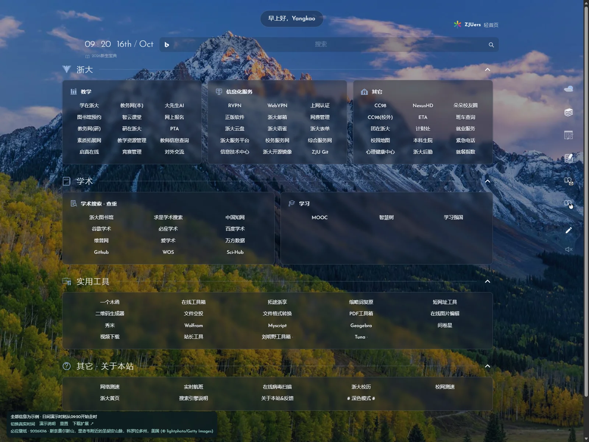
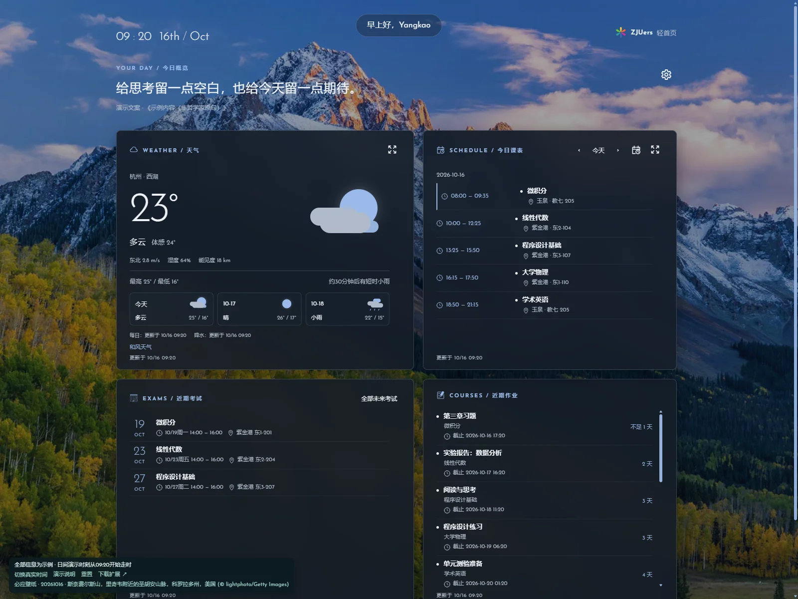
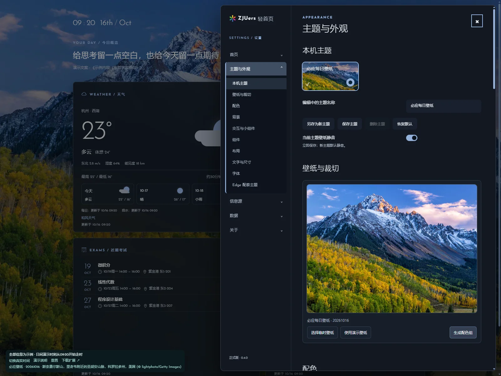
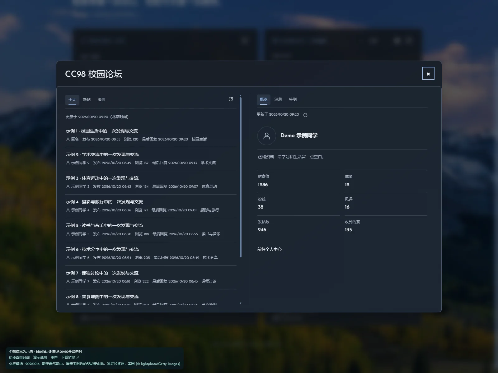

# ZJUers 个人首页

面向 Microsoft Edge 的个人起始页扩展。基于 [ZJUers 轻首页](https://zjuers.com/)完整页面及「ZJUers 轻首页美化」调整导航、视觉和交互，加入主题、次级信息界面与小组件。桌面版 **1.0.0 发布候选**已准备，远端版本与在线演示以实际发布结果为准。移动端作为后续独立版本。

<p align="center">
  <a href="https://yangkao.github.io/-Self-use-only-zjuers.com---ui-remake/">
    
  </a>
</p>

<p align="center">
  <strong><a href="https://yangkao.github.io/-Self-use-only-zjuers.com---ui-remake/">立即体验在线演示 ↗</a></strong>
  · <a href="https://github.com/yangkao/-Self-use-only-zjuers.com---ui-remake/releases/latest">下载扩展</a>
  · <a href="docs/demo.md">演示范围与说明</a>
</p>

[](https://yangkao.github.io/-Self-use-only-zjuers.com---ui-remake/)

> 无需安装、无需账号，点击上方按钮或截图即可体验。演示中的天气、课表、考试、作业与 CC98 信息均为合成示例；截图使用 2026-10-16 的必应壁纸，在线壁纸随每日部署更新。

这是个人定制项目，现公开源代码供修改与分发；与浙江大学、ZJUers、nightTab、Celechron、CC98 等项目没有官方隶属或背书关系。

## 功能

- 新标签进入 zjuers.com，读取原站导航并应用定制界面；原站连接失败时创建原生新标签并关闭失败页。
- 两级导航、分组折叠、就地编辑、拖动排序、自定义卡片和条目；个人规则与原站内容分别保存。
- Bing 默认搜索，多搜索引擎、分时问候、可选秒数显示。
- 必应每日壁纸及自动配色；本机图片／视频引用、裁切、主题管理、视觉参数；另行导出 Edge 静态配色主题 ZIP。
- 次级天气、课表、考试、作业；天气详情与学期课表总览。
- CC98 只读专栏：十大、新帖、版面目录、个人概览、分类消息、只读私信及签到月历；共享状态的放大视图与窄屏布局。
- 新建纯色／图片／视频主题，多帧、范围或单帧取色，颜色锁定与恢复；经典样式、适度融合及液态玻璃三种材质（液态玻璃为试验功能，可能存在渲染问题）。
- 可配置首页小组件：天气、课程、考试、作业、CC98 未读与十大、专注计时、秒表、间歇计时及日期倒计时。
- 首页配置导入导出、唯一一份导入前恢复副本；凭据、令牌和信息缓存不进入配置导出。

## 界面预览

### 次级信息界面

天气、当天课表、近期考试与作业集中呈现；天气和课表可打开详情。

[](https://yangkao.github.io/-Self-use-only-zjuers.com---ui-remake/)

### 主题与设置

侧边设置面板容纳主题、壁纸裁切、配色、布局与信息源配置。在线演示可体验临时壁纸与配色，账号表单禁用。

[](https://yangkao.github.io/-Self-use-only-zjuers.com---ui-remake/)

### CC98 只读专栏

十大、新帖与版面浏览，配合个人概览、消息和签到月历；展开视图与卡片共享浏览状态。以下内容均为虚构示例。

[](https://yangkao.github.io/-Self-use-only-zjuers.com---ui-remake/)

配图均来自示例数据演示。壁纸摄影署名：© lightphoto/Getty Images，通过必应每日壁纸展示；相关权利归原权利人所有。

## 安装与使用

下载 Release 中的 **`zjuers-home-1.0.0.zip`**，解压后在 `edge://extensions/` 开启开发人员模式，选择「加载解压缩的扩展」，选中包含 `manifest.json` 的目录。

首次安装使用默认设置，**没有预置账号、密码、天气 Key、令牌、个人本地壁纸或配置备份**。CC98 应用 ID 是公开标识符，保留默认值；其他账号授权能力尚未经跨账号验证，也可填写自己的应用 ID。

主界面空白处右键进入次级界面，次级界面非控件空白处左键返回。通过次级界面齿轮进入设置；编辑主界面入口位于右侧组件列。

[安装与升级](docs/install.md) · [信息源与配置](docs/configuration.md) · [隐私与权限](docs/privacy.md) · [开发与构建](docs/development.md) · [版本说明](docs/release.md)

## 开发

仅需要已有的 Python 3.11+、Node.js 22+，无需 npm 安装或 Git LFS。

```powershell
node --test srcs/extension/tests/*.test.cjs tests/*.test.cjs
python srcs/build-release.py
```

产物位于 `bin/release/`。`srcs/extension/` 是完整源码与测试；构建不读取个人浏览器配置，也不依赖项目外媒体、原始参考素材或临时目录。

## 已知限制

- 需要原站和相应信息源可达，不是离线导航站；学校接口或认证规则变化可能需要维护。
- 本地视频性能取决于文件、浏览器和硬件；多标签页可能重复占用解码资源。本项目没有完成低配硬件认证。
- 浏览器可能阻止自动有声播放；主题的非静音偏好不能绕过浏览器自动播放策略。
- 液态玻璃为试验功能，可能存在渲染滞后；WebGL 不可用时回退适度融合。
- 校内自动登录可能受到验证码、二次验证和 WebVPN 会话限制；WebVPN 账号单独配置。
- 配置导入不会迁移文件读取授权或凭据。原文件需要用户在当前设备重新选择授权。

## 许可与来源

本项目代码以 **GPL-3.0-only** 发布，允许在遵守许可证的条件下修改和分发；不提供担保。字体、图标、标识及外部内容的适用权利分别见 [第三方说明](THIRD_PARTY_NOTICES.md)。代码许可证不授予第三方商标权或外部服务使用资格。

nightTab 的时间、搜索及设置相关样式／交互已作适配；校内接入参考 Celechron 的公开实现与接口行为。许可证全文见 [LICENSE](LICENSE)。
